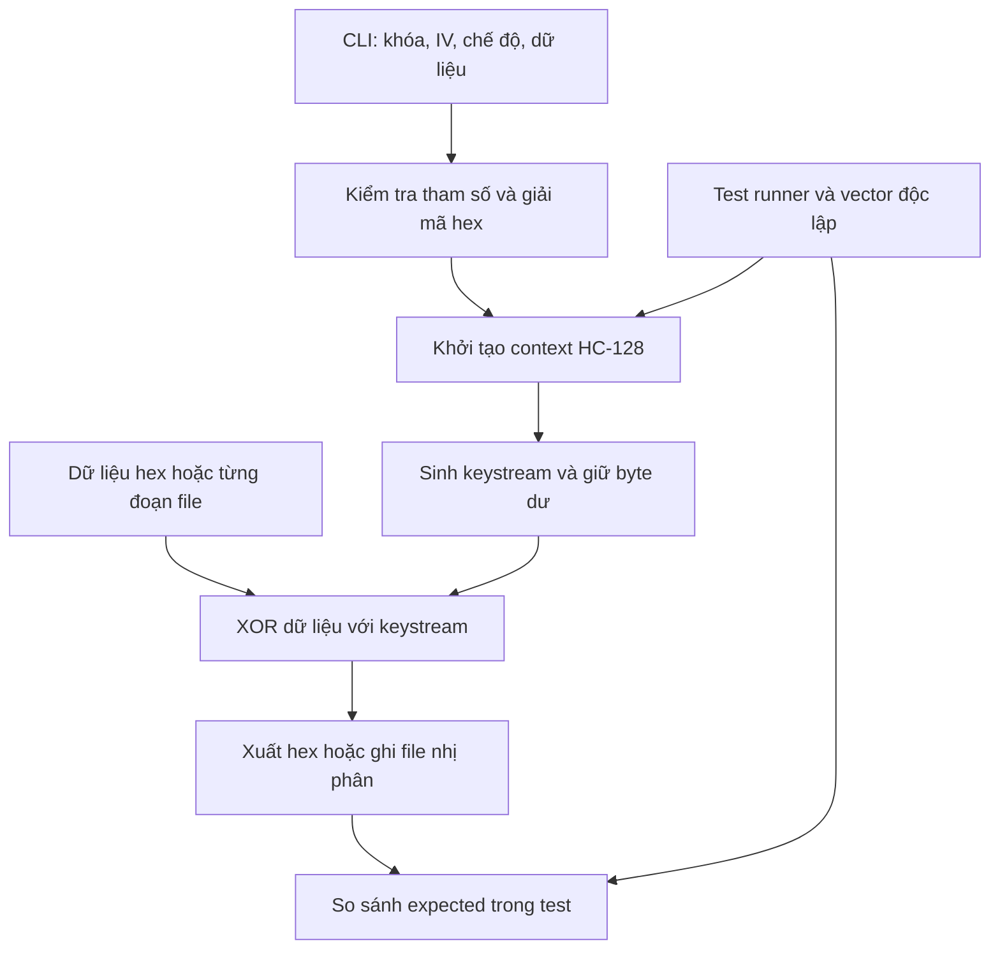

# Triển khai thuật toán mã dòng HC-128 trong eSTREAM bằng C

> Tài liệu hướng dẫn triển khai và phân công bài tập lớn cho nhóm 10 thành viên.
> Đây là kế hoạch thực hiện: cây thư mục, API, lệnh chạy và sản phẩm bên dưới là quy ước nhóm cần triển khai, chưa phải xác nhận đã có chương trình hoặc đã chạy PASS các test.

## 1. Thông tin dự án và thành viên

| Nội dung | Thông tin |
|---|---|
| Học phần | Lý thuyết mật mã |
| Giảng viên | TS. Tạ Thị Kim Huệ |
| Nhóm | 4 |
| Đề tài | Triển khai thuật toán HC-128 trong eSTREAM |
| Ngôn ngữ | C |
| Môi trường chuẩn | Ubuntu hoặc Ubuntu trên WSL; GCC, GNU Make, Git |
| Repository | https://github.com/thanhtrung2303/BTL-LTMM-Nhom-4-HC-128 |


Mã TV được giữ cố định trong Issue, Pull Request (PR), báo cáo và minh chứng kiểm thử.

| Mã | Họ và tên | MSSV | Vai trò chính | |
|---|---|---|---|---|
| TV01 | Nguyễn Thành Trung | 20233680 | Trưởng nhóm, tích hợp, build và CI |
| TV02 | Tăng Tiến Dũng | 20233350 | Đặc tả thuật toán, phép toán 32 bit | 
| TV03 | Phạm Quốc Cường | 20233295 | Mở rộng khóa và khởi tạo trạng thái | 
| TV04 | Đồng Xuân Quang | 20233603 | Cập nhật trạng thái và sinh keystream | 
| TV05 | Vũ Khắc Hùng | 20233428 | API xử lý byte, mã hóa và giải mã | 
| TV06 | Đặng Quốc Anh | 20233240 | CLI và kiểm tra dữ liệu nhập | 
| TV07 | Nguyễn Anh Tú | 20233691 | Test vector chuẩn, bộ chạy KAT | 
| TV08 | Nguyễn Tuấn Việt | 20233713 | Xử lý file và kiểm thử tích hợp | 
| TV09 | Trần Thái Sơn | 20233625 | Kiểm thử đối chiếu độc lập, sanitizer |
| TV10 | Trần Văn Vinh | 20223829 | Benchmark, tổng hợp tài liệu và demo |

## 2. Mục tiêu và phạm vi

Nhóm cần hoàn thành:

1. Giải thích nguyên lý mã dòng, vị trí của HC-128 trong eSTREAM, cấu trúc trạng thái, quá trình khởi tạo và sinh keystream.
2. Tự triển khai lõi HC-128 bằng C, tách khỏi giao diện dòng lệnh và thao tác file.
3. Mã hóa, giải mã dữ liệu nhị phân bằng phép XOR với keystream; hỗ trợ xử lý theo từng đoạn.
4. Kiểm định bằng test vector có nguồn, thể hiện rõ Input, Expected Output, Actual Output và kết quả so sánh.
5. Xây dựng báo cáo, slide, demo và minh chứng đóng góp của 10 thành viên.

**Phạm vi bắt buộc:** lõi HC-128, CLI, mã hóa/giải mã file, KAT, test biên, test streaming, build tự động, báo cáo và slide. Benchmark đơn giản là phần bổ trợ của nhóm, không thay thế kiểm định thuật toán.

**Ngoài phạm vi:** GUI, giao thức mạng, quản lý khóa trong sản phẩm thực tế, tối ưu SIMD/assembly, chứng minh an toàn mật mã. Không dùng thư viện có sẵn để thay thế lõi HC-128 tự viết; chỉ dùng triển khai độc lập làm đối chứng kiểm thử.

## 3. Sản phẩm bàn giao và đối chiếu yêu cầu

| Yêu cầu | Sản phẩm phải nộp | Minh chứng / tiêu chí |
|---|---|---|
| Làm theo nhóm | Bảng thành viên, phân công, Issue và PR | 10 thành viên đều có sản phẩm và review được ghi nhận |
| Trình bày thuật toán | Báo cáo PDF và slide | Đúng đặc tả, có sơ đồ, giải thích khởi tạo và sinh dòng khóa |
| Code chương trình | Mã C, header, Makefile, hướng dẫn | Clone sạch, build và chạy được theo README |
| Chạy test vectors Input/output | Dữ liệu vector, test runner, log | Đối chiếu từng byte với expected lấy từ nguồn độc lập |
| Báo cáo và trình bày | File nguồn báo cáo/slide, PDF, kịch bản demo | Nội dung nhất quán với code và kết quả thực tế |
| Khả năng tái lập | Release gắn commit, môi trường và lệnh chạy | Người khác chạy lại được bộ test trên cùng dữ liệu |

Gói nộp gồm mã nguồn tại tag `v1.0.0`, `README.md`, `docs/report/report.pdf`, `docs/slides/slides.pdf`, file nguồn tài liệu, `results/` và `docs/demo.md`. Không chỉ nộp ảnh chụp PASS; phải có dữ liệu và lệnh để tái lập.

## 4. Cơ sở thuật toán và quy ước triển khai

HC-128 do Hongjun Wu thiết kế, thuộc nhóm thuật toán hướng tới phần mềm của eSTREAM. Thuật toán dùng khóa 128 bit, IV 128 bit và hai bảng P, Q, mỗi bảng 512 từ 32 bit. Mỗi bước sinh một từ keystream 32 bit [1][2].

| Thành phần | Quy ước |
|---|---|
| Khóa và IV | Mỗi giá trị đúng 16 byte; CLI nhận đúng 32 ký tự hex |
| Số học | Dùng `uint32_t`, phép cộng modulo 2^32; không dựa vào tràn số có dấu |
| Biểu diễn byte | Load/store little-endian tường minh; không ép con trỏ byte sang con trỏ word |
| Trạng thái | P[512], Q[512], bộ đếm modulo 1024, bộ đệm byte keystream còn dư |
| Khởi tạo | Mở rộng khóa/IV, nạp P/Q, thực hiện giai đoạn khởi tạo theo đặc tả rồi mới xuất keystream |
| Streaming | Giữ trạng thái giữa các lần gọi, kể cả khi độ dài không chia hết cho 4 |
| Mã hóa | C = M XOR S |
| Giải mã | M = C XOR S, khởi tạo context mới với cùng khóa và IV |

TV02 phải trình bày đầy đủ các hàm f1, f2, g1, g2, h1, h2 và chỉ số theo tài liệu [1]. TV03 phải đặc biệt kiểm tra giai đoạn khởi tạo 1024 bước có ghi phản hồi vào bảng theo đặc tả; không tự thay bằng thao tác bỏ đi 1024 từ đầu ra của một hàm sinh thông thường. TV04 kiểm tra các điểm chuyển P sang Q và quay vòng bộ đếm.

HC-128 chỉ cung cấp mã hóa, không tự xác thực dữ liệu. Sai khóa/IV hoặc bản mã bị sửa không nhất thiết tạo ra lỗi chương trình. Không tái sử dụng cùng cặp khóa–IV cho các bản tin độc lập; việc lặp lại cặp khóa–IV trong test là có chủ đích để tái lập kết quả.

## 5. Kiến trúc, cây thư mục và luồng dữ liệu

### 5.1. Cây thư mục dự kiến

```text
hc128-project/
├── README.md
├── Makefile
├── .gitignore
├── .github/
│   ├── workflows/ci.yml
│   └── pull_request_template.md
├── include/
│   └── hc128.h                 # API công khai và context — TV01, TV05
├── src/
│   ├── hc128_internal.h        # Helpers nội bộ, hợp đồng init/step — TV02
│   ├── hc128_init.c            # Mở rộng khóa, khởi tạo — TV03
│   ├── hc128_core.c            # Cập nhật P/Q, sinh word — TV04
│   └── hc128_stream.c          # Bộ đệm byte và XOR — TV05
├── app/
│   ├── main.c                 # Điều phối CLI — TV06
│   ├── hex.c
│   ├── hex.h                  # Chuyển đổi hex — TV06
│   ├── file_io.c
│   └── file_io.h              # Đọc/ghi file nhị phân — TV08
├── tests/
│   ├── test_main.c            # Bộ chạy test, lọc theo nhóm — TV01
│   ├── test_helpers.c         # T02 — TV02
│   ├── test_init.c            # T03 — TV03
│   ├── test_core.c            # T04 — TV04
│   ├── test_stream.c          # T05 — TV05
│   ├── test_cli.sh            # T06 — TV06
│   ├── test_kat.c             # T07 — TV07
│   ├── test_files.sh           # T08 — TV08
│   ├── test_differential.c    # T09 — TV09
│   ├── vectors/
│   │   ├── README.md          # Nguồn, phiên bản, quy tắc đổi byte
│   │   ├── manifest.csv       # Danh sách case và nguồn đối chiếu
│   │   └── kat.txt            # Input và expected độc lập
│   └── fixtures/              # File mẫu nhỏ, công khai
├── bench/
│   └── bench_hc128.c          # T10 — TV10
├── tools/
│   └── reference/             # Adapter đối chứng, provenance — TV09
├── docs/
│   ├── design.md              # Đặc tả, API, luồng dữ liệu
│   ├── test-plan.md
│   ├── demo.md
│   ├── report/                # File nguồn và PDF báo cáo
│   └── slides/                # File nguồn và PDF slide
├── results/                   # Log của bản bàn giao, thông tin môi trường
└── build/                     # File sinh ra; không commit
```

Mỗi file có một chủ trì. TV01 chốt giao diện dùng chung trước; thay đổi API phải cập nhật tài liệu và thông báo các thành viên phụ thuộc qua Issue/PR.

### 5.2. Phân lớp và luồng dữ liệu



Lõi không gọi `printf`, không đọc file, không xử lý chuỗi hex và không có trạng thái toàn cục thay đổi được. Mỗi context biểu diễn một dòng dữ liệu riêng. Bộ kiểm thử gọi trực tiếp API lõi và chạy thêm test CLI/file.

### 5.3. Hợp đồng API phải chốt trước khi code

| API dự kiến | Trách nhiệm | Điều kiện |
|---|---|---|
| `hc128_init(ctx, key, iv)` | Tạo trạng thái từ hai mảng 16 byte | Kiểm tra con trỏ; reset bộ đếm và byte dư |
| `hc128_keystream(ctx, out, len)` | Sinh đúng `len` byte | Tiếp tục dòng hiện tại, không tự khởi tạo lại |
| `hc128_xor(ctx, in, out, len)` | XOR dữ liệu với dòng khóa | Hỗ trợ `in == out`; không hỗ trợ chồng lấn một phần |

Chốt kiểu trả về `int`: 0 thành công, khác 0 khi đối số không hợp lệ. Context phải được khởi tạo trước khi sinh dữ liệu. Với `len == 0`, cho phép buffer NULL, context vẫn phải hợp lệ và không bị tiến trạng thái; với `len > 0`, buffer phải hợp lệ. API không thể kiểm tra dung lượng thực tế của vùng nhớ do caller cấp: đây là tiền điều kiện phải ghi trong header.

## 6. Phân công công việc và nghiệm thu cá nhân

| Thành viên | Nội dung thực hiện | Sản phẩm cụ thể | Điều kiện nghiệm thu |
|---|---|---|---|
| TV01 | Chốt API, tổ chức repository, Makefile, CI, tích hợp | Header, test runner, CI, release checklist | Build từ clone sạch; test fail làm CI fail; lệnh README khớp thực tế |
| TV02 | Đọc đặc tả; mô tả hàm phụ, số học và endian | `design.md`, helpers, T02 | Công thức có nguồn; test rotate/load/store đạt; reviewer kiểm tra độc lập |
| TV03 | Mở rộng khóa/IV, nạp bảng, khởi tạo | `hc128_init.c`, T03 | Trạng thái đối chiếu phù hợp; reset tái lập đúng; qua KAT khi tích hợp |
| TV04 | Cập nhật P/Q, counter, sinh từ 32 bit | `hc128_core.c`, T04 | Đúng vùng chuyển bảng, đúng quay vòng; khớp keystream đối chứng |
| TV05 | Đóng gói byte, giữ byte dư, XOR, in-place | `hc128_stream.c`, T05 | Chia đoạn và một lần cho cùng kết quả; xử lý độ dài lẻ đúng |
| TV06 | Thiết kế CLI, hex, mã thoát và thông báo lỗi | `main.c`, `hex.*`, T06 | Lệnh hợp lệ chạy đúng; đầu vào sai bị từ chối trước xử lý dữ liệu |
| TV07 | Thu thập, kiểm tra nguồn vector, viết KAT | Vector, manifest, `test_kat.c`, T07 | Expected có nguồn độc lập; so từng byte; log chỉ rõ vị trí sai |
| TV08 | Đọc/ghi nhị phân theo chunk và kiểm thử file | `file_io.*`, fixture, T08 | File rỗng/lẻ/lớn chạy đúng; không mất byte; xử lý lỗi I/O đúng |
| TV09 | Đối chiếu implementation độc lập; sanitizer | Adapter đối chứng, T09, log | Bộ ca tái lập khớp đối chứng; không có lỗi ASan/UBSan |
| TV10 | Benchmark, biên tập tài liệu, chuẩn bị demo | Benchmark, T10, báo cáo/slide tổng hợp | Kết quả đo có cấu hình; demo chạy lại được; đủ đóng góp của nhóm |

TV10 tổng hợp hình thức; từng thành viên tự viết phần chuyên môn của mình, chịu trách nhiệm giải thích code, test và sửa góp ý. TV01 không viết thay các phần chưa hoàn thành.

## 7. Ma trận kiểm thử

**Trạng thái ban đầu của toàn bộ test: NOT RUN.** Bảng này là yêu cầu triển khai, không phải báo cáo kết quả đã chạy. Mỗi nhóm test bên dưới phải được tách thành các case có ID riêng trong test runner hoặc script.

| Nhóm / chủ trì | Đầu vào và nội dung chính | Expected / cách kiểm định | Reviewer |
|---|---|---|---|
| T01 — TV01 | Clone sạch; build GCC/Clang; chạy tất cả test; chủ động tạo một assertion sai trên nhánh tạm | Build thành công với code hợp lệ; khi cố ý làm sai, runner và CI trả mã khác 0 | TV10 |
| T02 — TV02 | Word 0, toàn bit 1, một bit 1, `0x12345678`; rotate với số đếm dùng trong đặc tả; load/store chuỗi `00 01 02 03` | Kết quả tính độc lập; little-endian phải load thành `0x03020100`; kiểm tra modulo 2^32 | TV03 |
| T03 — TV03 | Khóa/IV zero và mẫu bất đối xứng; khởi tạo lại sau khi đã dùng context; snapshot tại các mốc init | Snapshot từ triển khai tham chiếu đã xác minh hoặc tính độc lập; khởi tạo lại tái lập dòng đầu | TV04 |
| T04 — TV04 | Sinh ít nhất 8193 byte; kiểm tra trước/sau word 511/512 và 1023/1024, đánh số từ 0 | So đối chứng quanh offset byte 2048 và 4096, qua nhiều chu kỳ; không chỉ so vài byte đầu | TV05 |
| T05 — TV05 | Dài 0, 1, 2, 3, 4, 5, 63, 64, 65; chia 1+3, 3+1, 5+7, chuỗi chunk có đoạn rỗng; in-place | Một lần bằng nhiều lần; so keystream/KAT; round-trip đúng; len=0 không tiêu thụ trạng thái | TV06 |
| T06 — TV06 | Key/IV 31, 32, 33 ký tự; hex chứa G; data hex lẻ; thiếu cờ; số byte âm/quá lớn; mode sai | Chỉ dữ liệu hợp lệ được chấp nhận; mã lỗi khác 0, thông báo stderr; không tạo output khi lỗi tham số | TV07 |
| T07 — TV07 | KAT zero; khóa một bit và IV một bit nếu có trong nguồn; các vector bất đối xứng; offset xa nếu nguồn cung cấp | Byte đầu ra khớp 100% expected; tối thiểu 3 cặp key–IV độc lập có nguồn và ít nhất 64 byte/cặp | TV09 |
| T08 — TV08 | File 0, 1, 3, 4, 5, 4095, 4096, 4097 byte và 1 MiB; chứa 00/FF; file không tồn tại; input trùng output | Round-trip byte-for-byte; bản mã cùng kích thước; mẫu cố định khớp xử lý một lần; lỗi I/O trả mã khác 0 | TV01 |
| T09 — TV09 | Ít nhất 100 ca có seed cố định, khóa/IV khác nhau, độ dài 0–16384; gọi xen kẽ 2 context; chạy ASan/UBSan | Khớp implementation độc lập ở mọi byte; context không ảnh hưởng nhau; không lỗi bộ nhớ/UB | TV02 |
| T10 — TV10 | Dữ liệu cố định 1 KiB, 1 MiB, 16 MiB; 1 lần làm nóng, ít nhất 5 lần đo; chạy demo từ release | Ghi thời gian và MiB/s, trung vị; xác minh output trước đo; demo KAT và file thành công | TV08 |

### 7.1. Quy tắc dữ liệu test vector

- Phân biệt **KAT từ tài liệu công bố** và **test đối chiếu từ implementation độc lập**; không ghi cả hai là “vector chính thức eSTREAM”.
- Ưu tiên tài liệu tác giả/eSTREAM. Khi dùng bản sao hoặc bộ vector của thư viện, ghi rõ nguồn, phiên bản/commit và cách kiểm tra chéo.
- Không dùng chương trình đang kiểm thử để sinh `expected` rồi tự xác nhận chương trình đó đúng.
- Nếu nguồn ghi word 32 bit, chuyển từng word sang byte little-endian; không đảo cả chuỗi tùy ý.
- Với offset khác 0, khởi tạo từ đầu rồi tiêu thụ đúng số byte trước đoạn cần so; không hiểu offset byte là số word.
- Mỗi case chứa `id`, `source`, `source_case`, `key_hex`, `iv_hex`, `offset_bytes`, `length_bytes`, `input_hex` nếu có, và `expected_hex`.
- `manifest.csv` lưu đường dẫn nguồn, phiên bản, SHA-256 của file vector gốc, người nhập và người review. Không sửa expected chỉ để làm test PASS.
- Nếu chưa tìm được expected đáng tin cậy thì case ở trạng thái BLOCKED; không tự điền chuỗi giả.

### 7.2. Minh chứng Input/output bắt buộc

Log của mỗi KAT phải thể hiện theo mẫu sau; các dấu `<...>` là trường cần điền khi chạy thật:

```text
Case: <ID>
Source: <tài liệu / phiên bản / mã vector>
Key: <32 ký tự hex>
IV: <32 ký tự hex>
Offset bytes: <số nguyên>
Length bytes: <số nguyên>
Input: <plaintext hex hoặc mô tả sinh keystream>
Expected: <hex lấy từ nguồn độc lập>
Actual: <hex từ chương trình nhóm>
Result: <PASS hoặc FAIL>
First mismatch: <offset nếu FAIL>
```

Đối với KAT keystream, có thể dùng plaintext toàn 0: ciphertext khi đó chính là keystream. Báo cáo phải đưa ít nhất 3 ví dụ Input/output đầy đủ và bảng tổng hợp toàn bộ suite; dữ liệu dài được lưu trong file kèm offset thay vì chỉ chụp màn hình.

## 8. Review chéo bắt buộc

| Tác giả | Người review chính | Trọng tâm |
|---|---|---|
| TV01 | TV10 | Tái lập build, độ rõ hướng dẫn, quy trình release |
| TV02 | TV03 | Công thức, phép xoay, endian, nguồn tham khảo |
| TV03 | TV04 | Chỉ số mở rộng khóa, cập nhật khi khởi tạo, reset |
| TV04 | TV05 | Trạng thái P/Q, counter và chuyển word thành byte |
| TV05 | TV06 | API, byte dư, len=0, in-place |
| TV06 | TV07 | Parser, validation, mã thoát, CLI phục vụ KAT |
| TV07 | TV09 | Tính độc lập của expected, nguồn và offset |
| TV08 | TV01 | Lỗi I/O, streaming, không ghi đè input |
| TV09 | TV02 | Tính độc lập của oracle, seed và cách đối chiếu |
| TV10 | TV08 | Cách đo, tài liệu, tính tái lập demo |

Reviewer phải checkout nhánh, chạy test liên quan, kiểm tra diff và ghi lệnh/kết quả vào PR. Với thay đổi lõi, chạy thêm KAT và test streaming. Không tự approve PR của mình. Góp ý chưa xử lý phải có phản hồi rõ ràng trước merge. Khi reviewer không thể tham gia, TV01 chỉ định một người khác và ghi lại trong PR.

## 9. Phân chia báo cáo, slide và thuyết trình

Đề xuất 20 slide, mỗi thành viên chịu trách nhiệm 2 slide; thời lượng điều chỉnh theo yêu cầu giảng viên. Phần demo có thể do TV10 điều phối, nhưng các tác giả phải trả lời được câu hỏi về phần mình.

| Thành viên | Phần báo cáo phụ trách | Slide | Nội dung trình bày |
|---|---|---|---|
| TV01 | Mở đầu, mục tiêu, tổ chức nhóm, kết luận nghiệm thu | 1–2 | Đề tài, yêu cầu và sản phẩm |
| TV02 | Cơ sở mã dòng, HC-128, ký hiệu và hàm phụ | 3–4 | Nguyên lý và cấu trúc P/Q |
| TV03 | Khởi tạo, mở rộng khóa/IV | 5–6 | Các giai đoạn và lỗi thường gặp |
| TV04 | Sinh keystream | 7–8 | Cập nhật bảng và counter |
| TV05 | API, XOR, streaming | 9–10 | Luồng mã hóa/giải mã và byte dư |
| TV06 | CLI và kiểm tra đầu vào | 11–12 | Cách sử dụng, ca lỗi |
| TV07 | Phương pháp KAT và nguồn vector | 13–14 | Input, expected, actual của ca chuẩn |
| TV08 | Xử lý file, kết quả tích hợp | 15–16 | Demo round-trip file, test biên |
| TV09 | Đối chiếu độc lập và độ đúng triển khai | 17–18 | Ma trận kết quả, sanitizer, giới hạn kết luận |
| TV10 | Hiệu năng, tổng hợp hạn chế, kịch bản demo | 19–20 | Benchmark, demo và hướng phát triển |

Báo cáo thống nhất: giới thiệu → thuật toán → thiết kế/triển khai → kiểm thử → kết quả/đánh giá → kết luận → tài liệu tham khảo và phụ lục đóng góp. Không đưa log dự kiến thành kết quả đo thật. Slide dùng sơ đồ và các đoạn code ngắn cần giải thích, không chép toàn bộ source.

## 10. Thứ tự triển khai và các cổng nghiệm thu

| Mốc | Công việc / phụ thuộc | Chủ trì | Điều kiện được chuyển bước |
|---|---|---|---|
| M0 | Điền thành viên, tạo repo, chốt phạm vi | TV01 + cả nhóm | Có Issue cho 10 người, reviewer và deadline cụ thể |
| M1 | Đọc đặc tả, chốt API, định dạng vector, CLI | TV01, TV02, TV07 | Có tài liệu thiết kế được review; có nguồn expected độc lập |
| M2 | Build skeleton, helpers, init, core | TV01–TV04 | Unit test liên quan đạt; KAT đầu tiên chạy khớp từ đầu đến cuối |
| M3 | API byte, CLI, xử lý file | TV05, TV06, TV08 | Streaming, len lẻ, round-trip và lỗi nhập liệu đạt |
| M4 | Hoàn thiện vector, differential, sanitizer | TV07, TV09; cả nhóm sửa lỗi | T01–T09 đạt; không còn test bắt buộc BLOCKED/SKIP |
| M5 | Benchmark, viết báo cáo/slide và demo | TV10 + cả nhóm | T10 đạt; số liệu và nguồn nhất quán với release candidate |
| M6 | Clone sạch, tổng duyệt, đóng gói | TV01 + toàn nhóm | Checklist chung/cá nhân hoàn tất, tag release đúng commit |

TV07 thu thập vector từ M1, không chờ lõi hoàn thành. TV06 và TV08 có thể triển khai theo API đã chốt trong lúc TV03/TV04 xây dựng lõi. Chỉ tối ưu hiệu năng sau khi đạt M4; mọi tối ưu phải chạy lại bộ kiểm thử liên quan.

### Điều kiện nghiệm thu cuối cùng

- [ ] Đủ 10 họ tên, MSSV và minh chứng đóng góp.
- [ ] Lõi HC-128 tự viết bằng C, đúng phạm vi và tách khỏi CLI/I/O.
- [ ] Tất cả KAT khớp từng byte với expected có nguồn.
- [ ] T01–T10 có kết quả thực tế; không còn lỗi làm sai thuật toán hoặc hỏng dữ liệu.
- [ ] GCC/Clang build không warning với cờ đã thống nhất; ASan/UBSan không báo lỗi trên suite.
- [ ] Clone sạch, build, test, demo theo README thành công.
- [ ] Báo cáo, slide, log, source và release tag nhất quán.
- [ ] Mọi thành viên có PR được review và có review cho người khác.

## 11. Hướng dẫn cài đặt và chạy dự án

**Lưu ý:** các lệnh sau là giao diện đích nhóm phải hiện thực. README này không kèm chương trình C; chỉ chạy được sau khi các module và Makefile được hoàn thành.

### 11.1. Môi trường chuẩn

Dùng Ubuntu hoặc Ubuntu trong WSL trên Windows, mở terminal Linux. Không trộn các lệnh dưới đây với terminal MSVC/PowerShell.

```bash
sudo apt update
sudo apt install build-essential clang git
```


```bash
git clone https://github.com/thanhtrung2303/BTL-LTMM-Nhom-4-HC-128
cd hc128-project
make
make test
```

Ghi phiên bản OS, `gcc --version`, `clang --version`, `make --version` và commit đang dùng trong `results/environment.txt` khi bàn giao. Các vector phải được lưu sẵn trong repo để chạy KAT không cần tải mạng.

### 11.2. Các target Makefile cần triển khai

| Lệnh | Hành vi bắt buộc |
|---|---|
| `make` | Build `build/hc128` với C11 và `-Wall -Wextra -Wpedantic` |
| `make test` | Chạy toàn bộ test chức năng T01–T09; test fail trả mã khác 0 |
| `make test-kat` | Chạy riêng KAT và in đầy đủ dữ liệu đối chiếu |
| `make test-sanitize` | Rebuild thư mục riêng với ASan/UBSan rồi chạy suite |
| `make bench` | Build và chạy T10 bằng cấu hình tối ưu được ghi lại |
| `make clean` | Xóa sản phẩm build, không xóa vector hoặc minh chứng đã lưu |

Test đối chiếu phải có adapter và implementation tham chiếu được cố định phiên bản, kèm giấy phép phù hợp nếu đưa vào repo. Không để `make test` âm thầm bỏ qua T09 vì thiếu dependency.

### 11.3. Giao diện CLI thống nhất

Các khóa/IV bên dưới chỉ là dữ liệu demo công khai.

Sinh 64 byte keystream, in dưới dạng hex:

```bash
./build/hc128 keystream --key 00000000000000000000000000000000 --iv 00000000000000000000000000000000 --bytes 64
```

Mã hóa 5 byte dữ liệu hex:

```bash
./build/hc128 encrypt --key 00000000000000000000000000000000 --iv 00000000000000000000000000000000 --hex 48656c6c6f
```

Để giải mã, dùng subcommand `decrypt`, cùng key/IV và truyền ciphertext thực tế từ lệnh trên vào `--hex`. Không dùng context đã tiêu thụ keystream của lần mã hóa để bắt đầu giải mã.

Mã hóa và giải mã file mẫu có sẵn trong repo:

```bash
./build/hc128 encrypt --key 00000000000000000000000000000000 --iv 00000000000000000000000000000000 --in tests/fixtures/sample.bin --out build/sample.enc
./build/hc128 decrypt --key 00000000000000000000000000000000 --iv 00000000000000000000000000000000 --in build/sample.enc --out build/sample.dec
cmp tests/fixtures/sample.bin build/sample.dec
```

`cmp` trả 0 khi hai file bằng nhau. File mã hóa chỉ chứa ciphertext thô, không tự chứa IV hay khóa; người giải mã phải cung cấp đúng IV. CLI phải từ chối input và output cùng file, kể cả alias được phát hiện qua định danh file, để tránh làm mất đầu vào. Lỗi ghi file phải trả mã khác 0 và xử lý file tạm/chưa hoàn chỉnh rõ ràng.

Lưu log KAT mà vẫn giữ được mã lỗi của test:

```bash
mkdir -p results
make test-kat > results/kat.log 2>&1
```

Runner phải tổng hợp số PASS/FAIL và trả mã khác 0 nếu có bất kỳ FAIL nào. Không coi việc tạo được file log là đã PASS.

## 12. Quy trình GitHub bắt buộc

1. **Issue trước khi triển khai:** mỗi nhiệm vụ có mục tiêu, file dự kiến, test ID, tiêu chí nghiệm thu, người làm, reviewer và hạn hoàn thành.
2. **Nhánh riêng từ `main`:** dùng `feat/TV03-init`, `test/TV07-kat`, `docs/TV10-slides` hoặc `fix/TV05-byte-buffer`.
3. **Commit có ý nghĩa:** ví dụ `feat(init): implement key and IV expansion`; không gom nhiều module không liên quan vào một commit.
4. **Test trước khi đẩy:** build và chạy test liên quan; sửa core/API phải chạy KAT và streaming.
5. **Mở PR:** liên kết Issue bằng `Closes #...`; mô tả thay đổi, lệnh test, kết quả thực tế và các hạn chế còn lại.
6. **Review chéo:** người được phân công kiểm tra code/tài liệu, chạy lại test và ghi nhận xét; tác giả xử lý góp ý.
7. **Merge có kiểm soát:** CI xanh, ít nhất một approval độc lập, không còn cuộc thảo luận bắt buộc chưa giải quyết. TV01 hoặc người được chỉ định thực hiện merge.
8. **Cập nhật sau merge:** các thành viên đồng bộ `main` trước nhiệm vụ kế tiếp; xóa nhánh đã merge khi phù hợp.

Ví dụ thao tác cho TV03:

```bash
git switch main
git pull --ff-only origin main
git switch -c feat/TV03-init
# Thực hiện công việc, build và test trước khi commit
git add src/hc128_init.c tests/test_init.c
git commit -m "feat(init): implement HC-128 initialization"
git push -u origin feat/TV03-init
```

Quản trị repo bật bảo vệ `main`: không push trực tiếp, yêu cầu PR, approval và status CI nếu gói GitHub hỗ trợ; nếu không hỗ trợ thì nhóm áp dụng cùng quy tắc bằng kiểm tra thủ công và ghi nhận trong PR. Không force-push nhánh chung; không sửa lịch sử của người khác. Khi có conflict ở API/lõi, trao đổi với chủ trì module và chạy lại test sau khi giải quyết.

Không commit `build/`, file object/executable, khóa thật hoặc dữ liệu cá nhân. Vector công khai được commit. Chỉ lưu log và số liệu chọn lọc gắn với bản bàn giao trong `results/`. Mọi mã nguồn bên thứ ba phải có nguồn và thông tin giấy phép.

## 13. Chính sách kiểm thử

1. **Độ đúng ưu tiên hơn tốc độ:** KAT là cổng bắt buộc; benchmark nhanh không bù cho sai một byte.
2. **Nhiều lớp:** unit → KAT → streaming → CLI/file → đối chiếu độc lập → sanitizer → demo release.
3. **Round-trip là bổ sung:** cùng một lỗi ở mã hóa và giải mã có thể tự triệt tiêu, nên round-trip không thay được KAT.
4. **Tái lập:** test dùng seed cố định, lưu ca lỗi, ghi compiler/cờ build/commit; không dựa vào dữ liệu ngẫu nhiên không thể tái tạo.
5. **Regression:** lỗi đã sửa phải có test tái hiện lỗi cũ; không xóa test để CI xanh.
6. **Trạng thái rõ ràng:** PASS, FAIL, BLOCKED, NOT RUN; SKIP không được tính PASS. Bản nộp không còn test bắt buộc bị bỏ qua.
7. **Expected được bảo vệ:** thay đổi vector phải có lý do, nguồn và review độc lập; giữ nguyên dấu vết dữ liệu gốc.
8. **CI mỗi PR:** build GCC/Clang, chạy suite; ít nhất một cấu hình sanitizer. Benchmark chạy ở bản release và không đặt ngưỡng tốc độ tùy tiện trên máy CI.
9. **Giới hạn kết luận:** test chứng minh sự phù hợp trên các ca đã chạy, không chứng minh tuyệt đối an toàn mật mã. Kiểm tra thống kê/avalanche nếu làm thêm chỉ là minh họa.
10. **Lỗi phải có Issue:** gồm commit, lệnh tái hiện, input, expected, actual, môi trường; người sửa và reviewer xác nhận đóng lỗi.

## 14. Checklist bàn giao từng thành viên

Mỗi người phải hoàn tất checklist chung:

- [ ] Điền họ tên, MSSV, GitHub; cập nhật Issue của mình.
- [ ] Bàn giao file/code đúng phạm vi, không còn TODO ảnh hưởng chức năng bắt buộc.
- [ ] Test do mình phụ trách có input, expected/tiêu chí, actual và kết quả thật.
- [ ] PR được review; đã xử lý nhận xét và đính kèm lệnh kiểm tra.
- [ ] Hoàn thành review cho người được phân công.
- [ ] Nộp phần báo cáo, slide và nguồn tham khảo; giải thích được phần mình.
- [ ] Ghi rõ phần chưa hoàn thành hoặc hạn chế, không ghi PASS khi chưa chạy.

| Thành viên | Checklist riêng trước nghiệm thu |
|---|---|
| TV01 | [ ] API chốt; [ ] Makefile/CI; [ ] clone sạch; [ ] tag đúng commit; [ ] đối chiếu đủ 10 người |
| TV02 | [ ] công thức có nguồn; [ ] endian/modulo rõ; [ ] T02; [ ] review T09 |
| TV03 | [ ] mở rộng khóa và init; [ ] reset byte dư; [ ] T03; [ ] review T02 |
| TV04 | [ ] bước sinh P/Q; [ ] biên counter; [ ] T04; [ ] review T03 |
| TV05 | [ ] API byte/XOR; [ ] streaming/in-place; [ ] T05; [ ] review T04 |
| TV06 | [ ] CLI/help; [ ] kiểm tra hex và số; [ ] T06; [ ] review T05 |
| TV07 | [ ] provenance vector; [ ] expected độc lập; [ ] log KAT T07; [ ] review T06 |
| TV08 | [ ] file nhị phân; [ ] lỗi I/O; [ ] T08; [ ] review T10 |
| TV09 | [ ] oracle cố định phiên bản; [ ] seed; [ ] T09/sanitizer; [ ] review T07 |
| TV10 | [ ] T10 và cấu hình đo; [ ] báo cáo/slide; [ ] demo; [ ] review T01 |

## 15. Kịch bản demo đề xuất

1. Giới thiệu yêu cầu, cấu trúc repo và vị trí lõi HC-128.
2. Build chương trình từ source; trình bày ngắn luồng init → keystream → XOR.
3. Chạy `make test-kat`; chọn một ca để giải thích key, IV, expected, actual và quy ước byte.
4. Chạy mã hóa/giải mã file, dùng `cmp` xác nhận dữ liệu phục hồi.
5. Minh họa một ca nhập sai key/IV về định dạng và cách chương trình từ chối.
6. Trình bày bảng kết quả, benchmark và hạn chế; chỉ rõ mã hóa thô không phát hiện sửa đổi bản mã.

Trước buổi báo cáo, chạy thử trên đúng máy trình bày; chuẩn bị source, vector và log để demo không phụ thuộc mạng. Không dùng ảnh chụp cũ thay cho chạy thật nếu giảng viên yêu cầu chạy trực tiếp.

## 16. Tài liệu tham khảo

1. Hongjun Wu, **The Stream Cipher HC-128**, trong *New Stream Cipher Designs: The eSTREAM Finalists*, LNCS 4986, 2008, tr. 39–47. [Đường dẫn đặc tả eSTREAM](https://www.ecrypt.eu.org/stream/p3ciphers/hc/hc128_p3.pdf). Nguồn chính cho công thức và khởi tạo; đường dẫn lưu trữ cũ có thể không truy cập được. TV02/TV07 phải lưu thông tin bản tài liệu thực tế sử dụng.
2. ECRYPT II, **The eSTREAM Portfolio**, phần Profile 1 / HC-128. [Bản báo cáo tại CORDIS](https://cordis.europa.eu/docs/projects/cnect/6/216676/080/deliverables/001-DSYM10v1.pdf). Dùng tham khảo bối cảnh và tham số thuật toán.
3. Rand project, **Mã nguồn `rand_hc::hc128` và các test đi kèm**. [Source trên docs.rs](https://docs.rs/rand_hc/latest/src/rand_hc/hc128.rs.html). Nguồn triển khai độc lập bổ sung, có dẫn tài liệu tác giả; khi sử dụng phải cố định phiên bản thay cho liên kết `latest`. Đây là implementation dùng HC-128 làm RNG, không phải API mã hóa của dự án nhóm.
4. [eSTREAM — ECRYPT Stream Cipher Project](https://www.ecrypt.eu.org/stream/). Trang dự án gốc; kiểm tra khả năng truy cập và ghi nguồn thay thế nếu dùng bản lưu trữ.

Các tài liệu trên dùng để định hướng triển khai. Nhóm phải bổ sung nguồn chính xác của từng vector đã nhập vào `tests/vectors/README.md`, gồm phiên bản, mã ca, độ dài, offset, quy tắc byte và ngày truy cập. Trong phiên soạn README, các nguồn [2] và [3] đọc được; PDF gốc [1] không tải được, vì vậy tài liệu này không chép các giá trị expected chưa xác minh và không tuyên bố đã chạy chương trình.
